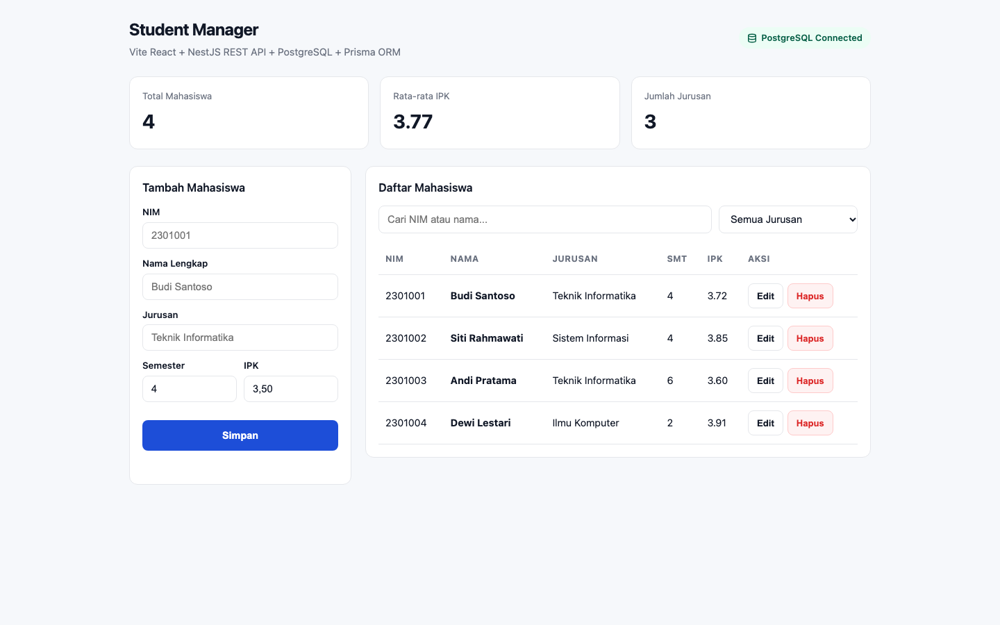
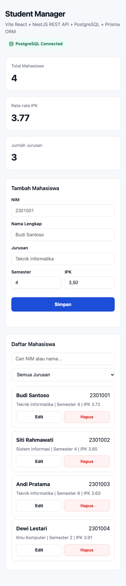
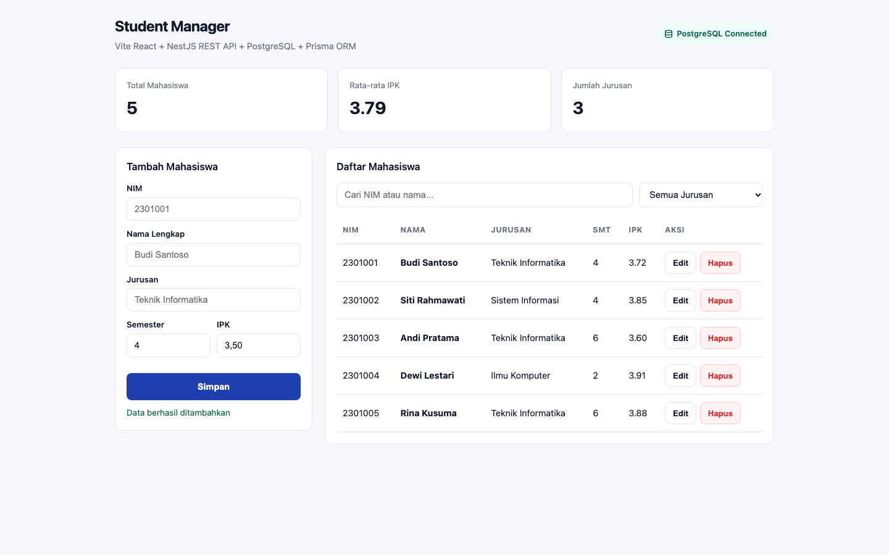
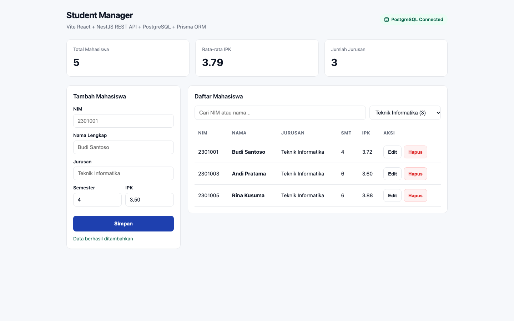
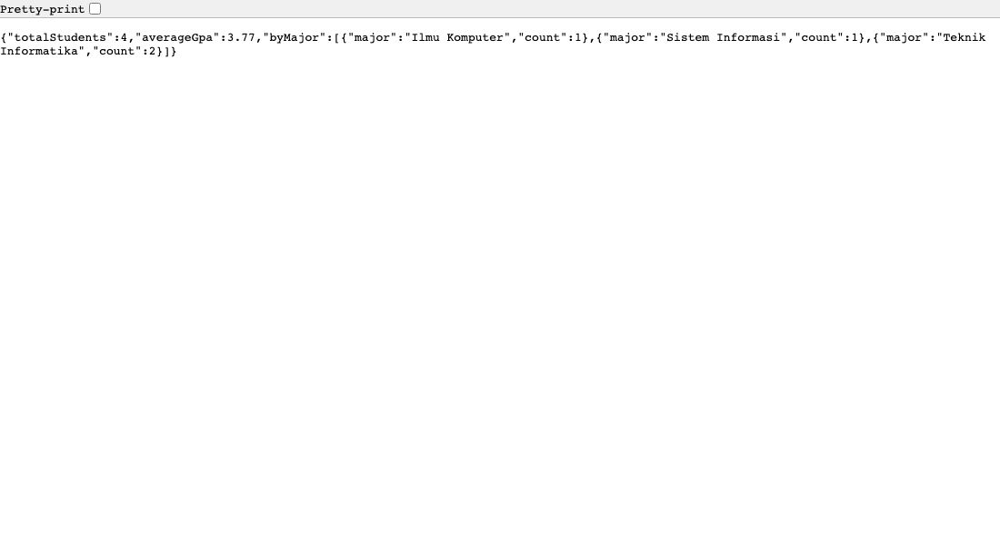

# Student Manager - Vite React + NestJS REST API + PostgreSQL + Prisma ORM

Aplikasi web fullstack manajemen data mahasiswa yang terdiri dari folder `frontend` (Vite + React) dan folder `backend` (NestJS + Prisma ORM + PostgreSQL) sehingga seluruh data tersimpan secara permanen di basis data.

## Fitur Utama

- Operasi CRUD lengkap (Create, Read, Update, Delete) untuk entitas `Student` melalui Prisma Client.
- Query lanjutan berupa filter berdasarkan jurusan (`where`) dan pencarian NIM/nama pada `GET /api/students`.
- Endpoint statistik (`GET /api/students/stats`) menggunakan `count`, `aggregate`, dan `groupBy` untuk menampilkan total mahasiswa, rata-rata IPK, serta jumlah mahasiswa per jurusan.
- Antarmuka web Vite + React responsif untuk tampilan desktop dan mobile yang terhubung ke REST API NestJS.

## Teknologi

- Frontend: Vite, React 19, CSS responsif
- Backend: NestJS (TypeScript, Express), Prisma ORM v6 (`prisma`, `@prisma/client`)
- Database: PostgreSQL 16 (Docker Compose)

## Struktur Proyek

```text
bab10-prisma-api/
├── backend/
│   ├── prisma/
│   │   ├── migrations/
│   │   ├── schema.prisma
│   │   └── seed.mjs
│   ├── src/
│   │   ├── prisma/
│   │   │   ├── prisma.module.ts
│   │   │   └── prisma.service.ts
│   │   ├── students/
│   │   │   ├── students.controller.ts
│   │   │   ├── students.module.ts
│   │   │   └── students.service.ts
│   │   ├── app.module.ts
│   │   └── main.ts
│   ├── test/
│   │   └── crud.test.mjs
│   ├── .env.example
│   ├── package.json
│   └── tsconfig.json
├── frontend/
│   ├── src/
│   │   ├── App.css
│   │   ├── App.jsx
│   │   └── main.jsx
│   ├── index.html
│   ├── package.json
│   └── vite.config.js
├── docs/
│   └── screenshots/
│       ├── 01-desktop-dashboard.png
│       ├── 02-mobile-dashboard.png
│       ├── 03-crud-create-desktop.png
│       ├── 04-filter-and-stats.png
│       └── 05-api-stats-json.png
├── docker-compose.yml
└── README.md
```

## Cara Menjalankan

### 1. Jalankan PostgreSQL

```bash
docker compose up -d
```

### 2. Jalankan Backend (NestJS + Prisma)

```bash
cd backend
cp .env.example .env
npm install
npx prisma migrate dev --name init
node prisma/seed.mjs
npm run build
npm start
```

Server backend berjalan di `http://localhost:3001`.

Untuk menjalankan pengujian CRUD, filter, dan statistik:

```bash
cd backend
npm test
```

### 3. Jalankan Frontend (Vite + React)

Buka terminal baru:

```bash
cd frontend
npm install
npm run dev
```

Aplikasi frontend berjalan di `http://localhost:5173` dan otomatis meneruskan request `/api` ke backend `http://localhost:3001`.

## Daftar Endpoint API

| Method | Endpoint | Deskripsi |
| --- | --- | --- |
| GET | `/api/students` | Menampilkan seluruh data mahasiswa. Mendukung query `?major=...` dan `?search=...` |
| GET | `/api/students/stats` | Menampilkan total mahasiswa, rata-rata IPK, dan jumlah per jurusan |
| GET | `/api/students/:id` | Menampilkan detail 1 mahasiswa berdasarkan ID |
| POST | `/api/students` | Menambahkan data mahasiswa baru |
| PATCH | `/api/students/:id` | Memperbarui data mahasiswa berdasarkan ID |
| DELETE | `/api/students/:id` | Menghapus data mahasiswa berdasarkan ID |

## Dokumentasi Screenshot

### 1. Tampilan Desktop (1440x900)



### 2. Tampilan Mobile (390x844)



### 3. Pengujian Create Data via UI



### 4. Filter Jurusan (Query where) dan Statistik



### 5. Response JSON Endpoint Statistik (`GET /api/students/stats`)


